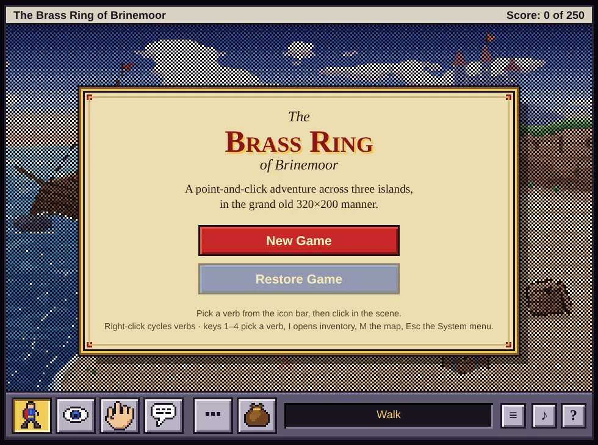
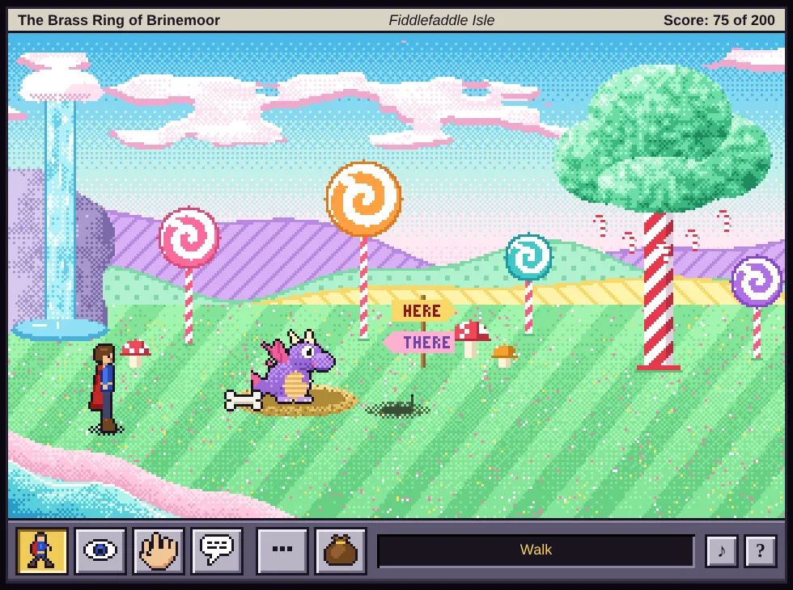
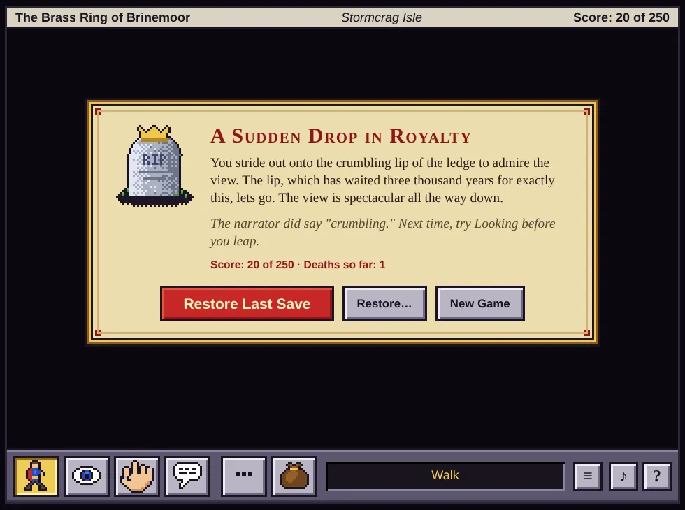
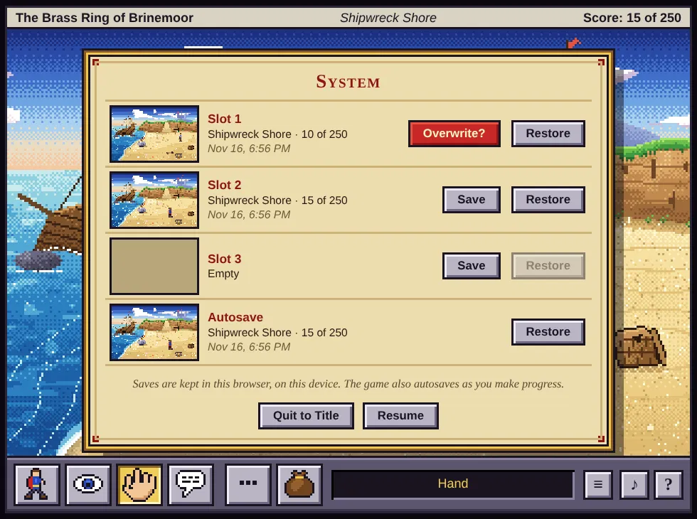

The King's Quest adventure games were an important part of my development years (it even inspired my middle name but that's another story). I played the series on the family 386, obsessively, for years. The whole Sierra line had a huge impact on me as a writer, a programmer and a thinker.

If you missed that era the gist is you steered a small hero around a hand-painted fairy tale, picked up anything that wasn't nailed down and tried every object on every person to make progress toward your character's goals and unlock the story. You died constantly and ridiculously, the game made fun of you for it, and you learned to save before doing anything brave.

So when Claude offered access to the Fable model as a two day trial, of course I had to direct it to build a clone to relive the feel of my beloved childhood adventures.

**The Brass Ring of Brinemoor** is a point-and-click adventure about Prince Rowan of Eldermere, who washes up shipwrecked on an island kingdom and has to find his way into the throne room of Castle Brinemoor. The world spans five islands that you travel between with a magic map. I had Claude build it in one long session over seven requests, each making the game bigger and more nuanced. It runs in a web browser from a single file, with nothing to install and nothing to download.

[Click Here to Try It!](/assets/brass-ring-of-brinemoor.html)



## An Homage Needs Its Own Names

For "copyright reasons" Claude refused to make an outright clone. That's fine, I was hoping for something that felt familiar without being a direct rip-off.

The original King's Quest was designed by Roberta Williams and first released for the IBM PCjr in May 1984 - a smidge before my time - and by the time I was able to read and type they were up to their fourth game. It was the sixth game - Heir Today, Gone Tomorrow - that really drew me into the franchise when we got our first CD-ROM drive. I had never experienced anything like it - beautiful hand-drawn backgrounds, real actors in video capture, even fully voiced dialog. I couldn't believe a game that detailed and advanced was possible.

In the original game, [a storm wrecks Prince Alexander's ship and leaves him the only survivor](https://www.mobygames.com/game/131/kings-quest-vi-heir-today-gone-tomorrow/), washed up on the Isle of the Crown. That island has dogs for castle guards, a pawn shop, a bookshop and a ferryman and another island in the kingdom keeps a Beast's garden and a hedge maze. My requests to Claude asked for all of those elements.

From the first request on, Claude swapped every name, character and place for an original, so the game stands as an homage and doesn't copy Sierra's material:

| King's Quest VI | Brass Ring |
|---|---|
| Isle of the Crown | Brinemoor |
| Isle of Wonder | Fiddlefaddle Isle |
| Isle of the Sacred Mountain | Stormcrag Isle |
| Isle of the Mists | Gloamwick Isle |
| Isle of the Beast | Thornwood Isle |
| Prince Alexander | Prince Rowan of Eldermere |

The swaps went past the names. I asked for a "Hermit's Hut," but the game already had a hermit (Barnaby, under a vow of silence on Stormcrag), so the hut became **The Alchemist's Hut** and went to Dame Hespera, a blind alchemist with a raven and a forty-foot knitted scarf. I asked for Minotaur puzzles and got a topiary lion in the hedge maze, whose tail points east while its eyes stare west. The ferryman became Old Tolliver, a ghost who drowned on a Tuesday and came in to work on Wednesday because nobody told him to stop.



The cursed Beast became Lord Bramblemane, a gentle eight-foot Beast in a green coat who guards the Royal Seal you need to win. Break his curse and he turns back into Chancellor Pim, a small elderly man cursed forty years ago for giving a travelling witch deliberately unhelpful directions through his maze, because he "thought it was funnier that way."

## Sierra Made Failure Cheap and Funny

*Everybody who played these games had a save file named something like "BEFORE THE BRIDGE" and another called "BEFORE THE BRIDGE 2."*

Sierra's games were famous for killing you. In King's Quest VI, poor choices or missteps will often prove fatal for the Prince. Across the Sierra catalogue [each death tended to get its own little scene](https://www.pcgamer.com/great-moments-in-pc-gaming-dying-in-sierra-adventure-games) instead of a plain game-over screen. The deaths were part of the fun. They taught you the rules of the world by breaking you against them, and they only stayed fun because restoring a save was quick.

Brass Ring has six deaths, and every one gets a Game Over window with a tombstone, a funny epitaph, a hint, your score, a death counter and a big **Restore Last Save** button. Step onto a crumbling cliff lip on Stormcrag and you earn "A Sudden Drop in Royalty." Push the goat blocking the stairs three times and you're "Butted Out." Board Tolliver's one-way ghost ferry after he warns you off and you've taken "The Last Crossing." The skeleton in the pitch-black cave on Gloamwick "appears to have died of not checking."



The controls came from the same era. Earlier King's Quest games had you type commands, but [King's Quest V replaced the text parser with an entirely mouse-driven point-and-click interface](https://www.filfre.net/?p=3191), and the sixth game kept it: an icon bar with walk, look, action and talk, where look gets you a description from the narrator. Brass Ring copies that layout with Walk, Look, Hand, Talk, your current item and an inventory pouch. There's no typed parser. The narrator gets a joke for every Look and for every action that fails, characters react to whatever you offer them and remember what they've already refused, and conversations are numbered menus where topics you've already asked about turn grey.

None of that is decoration. **A forgiving undo turns punishment into curiosity**, and that applies well beyond games. Players poke at a dangerous cliff when a restore costs them five seconds, and your users and teammates behave the same way. When you design anything people can break, ask yourself how cheap you've made the way back.

## Separate the Engine From the Story

Under the hood the whole game is plain HTML and JavaScript, bundled into one self-contained file with zero external assets - no images, no fonts and no libraries. Every pixel gets drawn in code on an HTML canvas, and every sound gets synthesised live with the Web Audio API. The screen is 320 by 200 pixels, the old VGA size, scaled up with crisp edges. A small homemade toolkit draws the shapes, with ordered (Bayer) dithering for VGA-era shading, noise functions for stone, fog and water, and item icons written as 16x16 grids of palette letters.

The source started modular and stayed that way. `src/engine/` holds a generic adventure engine that knows nothing about Brinemoor: drawing, audio, dialog, inventory, pathfinding, saves and input. `src/data/` holds the game itself, with one file per room and one per conversation. Data files only ever call registry functions:

```js
// A data file never reaches into the engine. It only registers things.
defineRoom(/* a room: art, exits, walkable area, hotspots */);
defineItems(/* inventory items and their icons */);
defineCombos(/* which pairs of items combine, and into what */);
defineTalk(/* a conversation menu and its topics */);
defineDeaths(/* death titles, epitaphs and hints */);
```

The goal was to be able to add fifteen or more rooms without touching the engine. The game grew to twelve rooms in three regions plus two bonus isles, and a Python script, `build.py`, bundles 45 modules into one `dist/index.html` of about 400,000 characters.

Left to its own devices Claude will happily add more and more code to a giant html file. I didn't necessarily plan to extend the prototype later but I didn't want to waste the (VERY EXPENSIVE) Fable credits on regressions and re-writes so I gave the model a bit of guidance to separate its assets into a reusable engine so the world could be expanded more cleanly.

## Make Broken Data Fail Loudly

A data-driven game has a sneaky failure mode: a typo doesn't crash anything, it just leaves a door that leads nowhere. So the game runs a validator at startup that checks every piece of game data and reports broken references by name, like an exit to a room that doesn't exist or an item reaction for an item nobody defined.

The validator couldn't catch everything. The build concatenates data files alphabetically, and one file tried to add portrait moods before the file defining them had loaded - the fix was moving that code into the right file. Another time, the function that paints the castle courtyard wasn't receiving the game state, so the new Seal socket in the castle doors never showed as filled until that was wired through.

Both bugs came down to order and plumbing rather than logic, which is unfortunately where generated code tends to slip. When you can't read every line, **build the check that reads them for you**, and make its error messages name the exact thing that's wrong so you can interpret them yourself without making your agent waste time going back and doing it for you.

## Put All the State in One Place

Every lasting fact about the world lives in one flags object, plus the inventory, score, current room and positions. A save stores exactly that and nothing else. Saves carry a version number, so an old save gets flagged instead of loaded wrongly, and they survive closing the browser, with an in-memory fallback if the browser blocks storage.

Since everything reads from those flags, the world changes as you play without any special save logic. Cut the thorny vines and they vanish and a new path opens up through the walkable area. The alchemist's cauldron changes colour as ingredients go in, and characters greet you differently once you've helped them.



## Tests Prove Exactly What They Check

*Everybody's test suite has at least one test that proves the code ran and nothing more.*

The game has a serious set of automated browser tests, driven by Playwright in headless Chrome. A full playthrough clicks through the entire puzzle chain to a perfect 250 out of 250 points, from the brass ring on the beach to the Royal Seal in the castle doors. Other tests play the puzzles in different orders, save and reload the page, and walk into every death. A "walk fuzz" sends the hero on hundreds of random walks in every room to make sure he never leaves the walkable area or strolls into the sea. The final build passes all of it with no script errors.

The tests had their own bugs. One hung forever because it waited on an in-game script that was itself waiting for a dialog to be dismissed.

## Saving Before the Next Brave Thing

I was surprised and delighted with the breadth of what came out of my short time with Fable. All fourteen screens, the full puzzle chain, item combining, dialogue with memory, six deaths with restore, save slots that survive a reload and the five-island map are all in.

There were so many unexpected details - the audio chimes, the smoke animations billowing from chimneys in the village, the animated waves loping against the beach. A lot of the puns and jokes made me laugh out loud. I was not expecting the level of **detail** that would emerge, and I had moments of feeling like a kid exploring a charming new world. Magical.

Those games taught me to save before doing anything brave, and to treat dying as information. It turns out they were teaching me how to build software the whole time.
