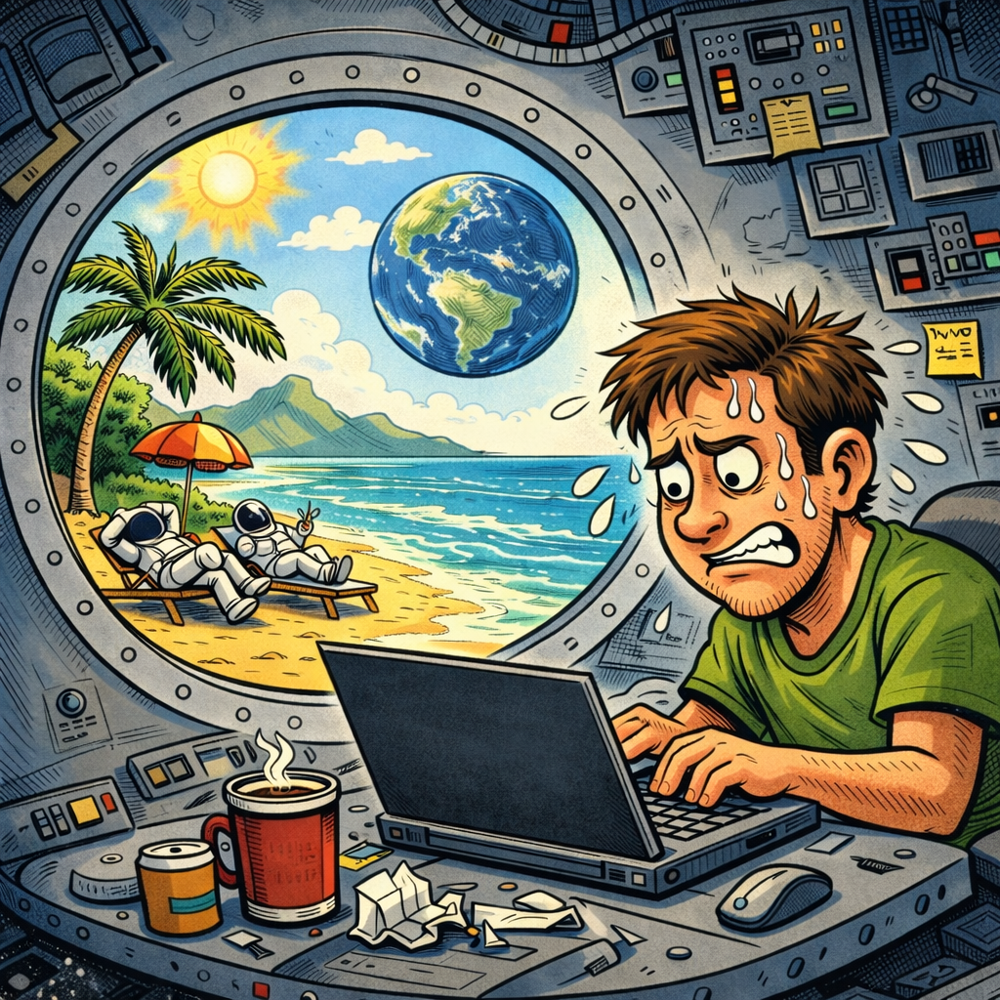

From ChatGPT

 Make a cartoon like you would find in a newspaper (on Sunday of course, in colour). Show a computer programmer working in his laptop inside an apollo space module. Outside the window the moon is a tropical beach with the earth in the sky. The programmer is stressed trying to code something on his laptop and visibly sweating, but it's ridiculous because the environment is so relaxing.

 Just one picture, not two panels. Maybe the astronauts in their space suits should be seen relaxing on the beach outside the window. No words or thought bubbles or speech bubbles

 There shouldn't be anything written on the back of the laptop. And the picture needs to be square.