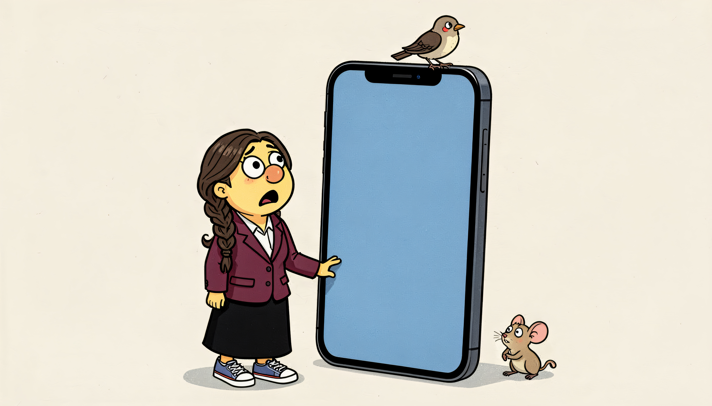

Used _Draw Things_

Prompt:

  The puppet character from Picture 1, keeping her face, felt texture and proportions exactly the same, with long dark brown hair in a single thick braid, wearing a burgundy blazer, a long black skirt and flat low-top canvas sneakers, stands tiny next to a gigantic smartphone with a blank screen, as tall as a house, with huge wide eyes and a small open mouth, amazed and puzzled. She only reaches the bottom of the phone. A bird sits on top of the phone. A tiny mouse stares up with wide eyes. Exaggerated size difference. Slightly high-angle full-body shot. Woodblock-print cartoon, flat colors, gentle wood grain. No text or letters.

| Field | Value |
|---|---|
| Model | flux_2_klein_4b_q8p.ckpt |
| Steps | 6 |
| Sampler | DDIM Trailing |
| Guidance Scale | 1.2 |
| Seed | 4155810490 |
| Seed Mode | Scale Alike |
| Size | 1344x768 |
| Strength | 1.0 |
| Shift | 1.2 |
| CLIP Skip | 2 |
| Upscaler | 4x_ultrasharp_f16.ckpt |
