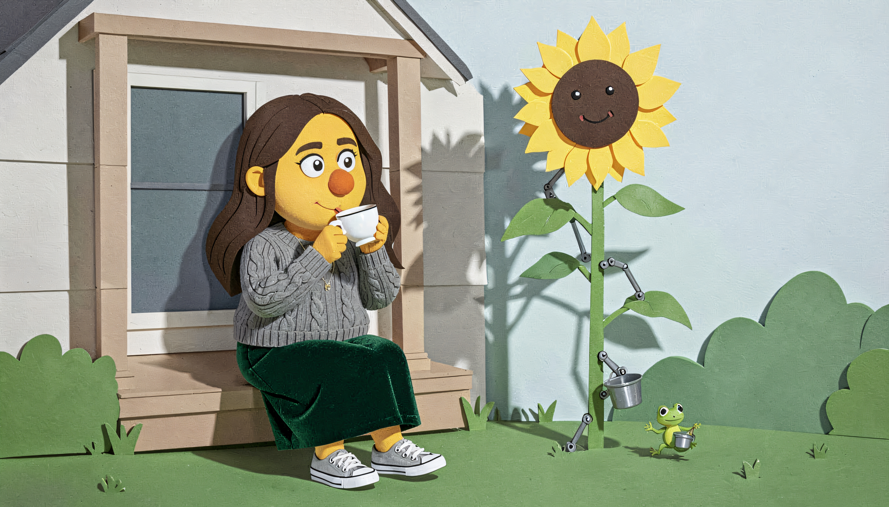

Used _Draw Things_

Prompt:

  The puppet character from Picture 1, keeping her face, felt texture and proportions exactly the same, with long dark brown hair to her waist, wearing a grey cable-knit sweater, a long emerald velvet skirt and flat low-top canvas sneakers, sips tea on a porch beside a sunflower taller than the house. The sunflower casts a huge shadow over the garden. A robot climbs the sunflower stem and slides down. A tiny frog hops away carrying a bucket. Medium-wide shot from the knees up. Paper cut-out cartoon, layered construction paper, soft shadows. No text or letters.

| Field | Value |
|---|---|
| Model | flux_2_klein_4b_q8p.ckpt |
| Steps | 7 |
| Sampler | DDIM Trailing |
| Guidance Scale | 1.2 |
| Seed | 1515863660 |
| Seed Mode | Scale Alike |
| Size | 1344x768 |
| Strength | 1.0 |
| Shift | |
| CLIP Skip | 2 |
| Upscaler | 4x_ultrasharp_f16.ckpt |
