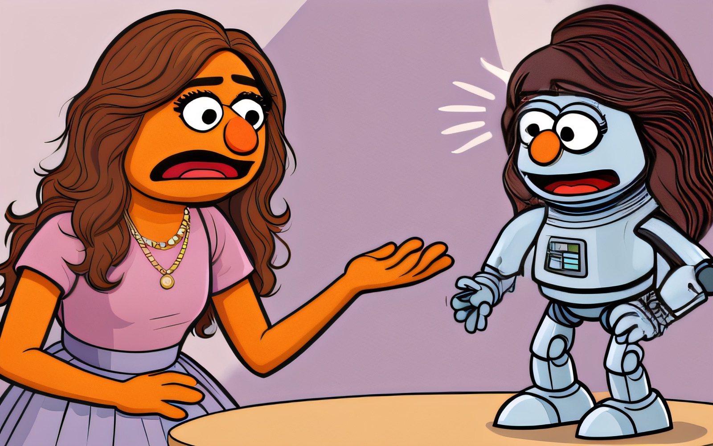

Used _Draw Things_

Prompt:

  flx_ematar, 2d cartoon illustration of a muppet puppet character wearing a long plum skirt, puzzled quizzical expression, facing a (chrome metal robot with long flowing brown wig:1.3), plain soft lavender background

Negative prompt:

  human, realistic, photograph, anime, text, letters, writing, pants, jeans, deformed hands, extra fingers, blurry, cropped

| Field | Value |
|---|---|
| Model | SDXL 1.0 Base |
| LoRA | flx_ematar |

Inpainting pass (robot's hair), with the mask covering the sides of the robot's head and down past its shoulders:

Prompt:

  beautiful brown hair falling down over the shoulders, on a chrome robot head

Negative prompt:

  short hair, afro, curly hair, black hair, animal ears, rabbit ears, bunny ears, horns, bald, shaved head

| Field | Value |
|---|---|
| Model | SDXL 1.0 Inpainting 0.1 |
| LoRA | none |
| Mode | Image to image |
