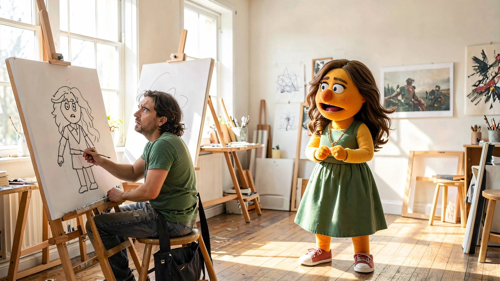

Used _Draw Things_

Prompt:

  A wide-angle shot of two people inside a sunlit art studio. On the right side, [describe your mood board subject] stands nervously in the center-right of the room, fidgeting with his hands. On the far left side in the foreground, a worried female artist sits at an easel, painting a crude stick-figure rendition of him onto a white canvas.

| Field | Value |
|---|---|
| Model | Flux 2.0 [klein] 4B |
