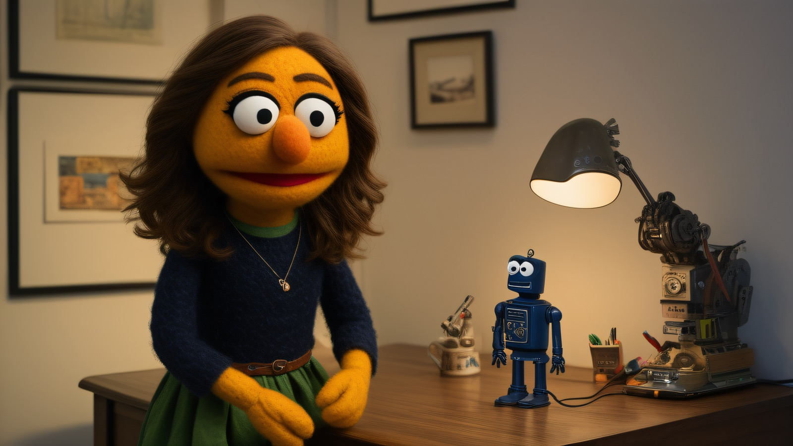

Used _Draw Things_

Prompt:

  muppetem, felt puppet woman, peachy orange felt skin, long brown hair, wearing a navy blue sweater and a dark green ankle-length skirt, standing with arms crossed and an annoyed expression, next to a small boxy robot with many mechanical arms frantically sawing a desk in half, painting the wall, and unscrewing a lamp at the same time, plain light grey wall, simple uncluttered composition, Muppet-style felt textures, comedic, soft studio lighting, photographic

Negative prompt:

  text, letters, words, writing, watermark, logo, orange clothing, peach clothing, skin-colored clothing, cluttered background, many objects, crowd, extra fingers, deformed hands, blurry

| Field | Value |
|---|---|
| Model | SD3 Large Turbo 3.5 |