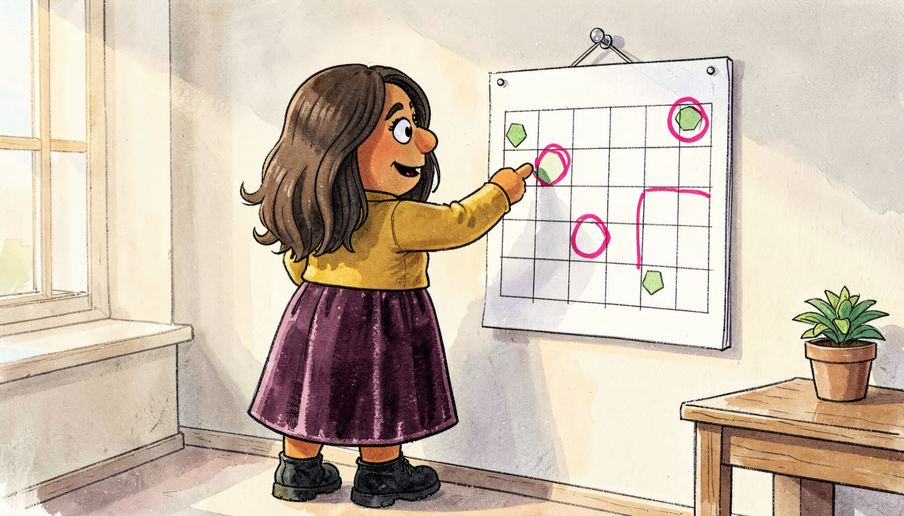

Used _Draw Things_

Prompt:

  flx_ematar, solo, single character, 2d cartoon illustration of a muppet puppet character, very long dark brown hair, cream sweater, long burgundy skirt to her ankles, skater shoes, cheerful determined expression, pinning a big blank paper wall calendar to a wall, two squares circled in bright pink marker, small green hexagon stickers on the calendar, plain soft yellow background

Negative prompt:

  human, realistic person, real skin, text, letters, pants, trousers, jeans, orange clothing, skin-colored clothes, numbers, writing, logo, watermark, two characters, multiple characters, duplicate, photograph, anime, deformed hands, extra fingers, extra limbs, blurry, cropped

| Field | Value |
|---|---|
| Model | SDXL 1.0 Base |
| LoRA | flx_ematar |
