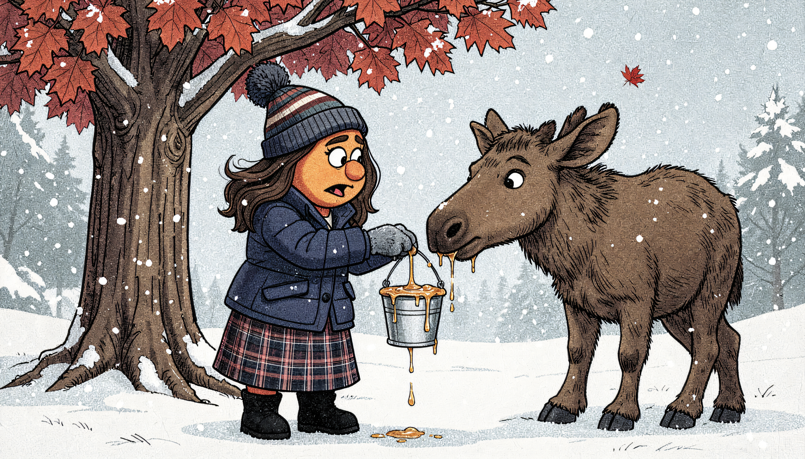

Used _Draw Things_

Prompt:

  The puppet character from Picture 1, keeping her face, felt texture and proportions exactly the same, with long dark brown hair tucked behind her ears, wearing a navy puffer coat, a long plaid skirt and black winter boots, with a striped toque with a pom-pom and mittens, tapping maple syrup into a bucket hung on a snowy maple tree. A curious moose leans in to sniff the bucket. Syrup drips onto the moose's nose. A red maple leaf drifts down through the falling snow. Wide shot, her in the center. Risograph-print cartoon, grainy two-tone inks. No text or letters.

| Field | Value |
|---|---|
| Model | flux_2_klein_4b_q8p.ckpt |
| Steps | 7 |
| Sampler | DDIM Trailing |
| Guidance Scale | 1.4 |
| Seed | 2497939031 |
| Seed Mode | Scale Alike |
| Size | 1344x768 |
| Strength | 1.0 |
| Shift | Not recorded |
| CLIP Skip | 2 |
| Upscaler | 4x_ultrasharp_f16.ckpt |
