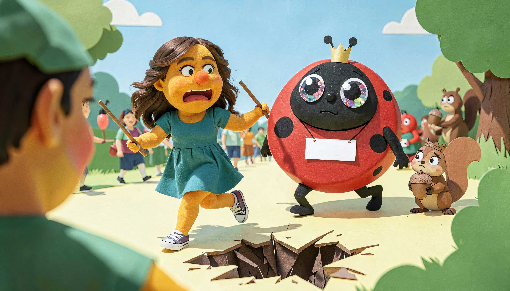

Used _Draw Things_

Prompt:

  The puppet character from Picture 1, same face, felt texture and proportions, with long dark brown hair tucked behind her ears, wearing a flowy teal sundress and flat low-top canvas sneakers, gasping with glee, one leg kicked up, marching at the front of a parade, swinging a baton, knees high. A giant chubby ladybug with huge sparkly eyes marches beside her, as tall as she is. Hot sunny summer day. The ladybug wears a blank name tag and a tiny crown. A squirrel clutches an acorn and stares nervously. Over-the-shoulder shot looking down past her shoulder at what's cracking below. Paper cut-out cartoon, layered construction paper. No text or letters.

| Field | Value |
|---|---|
| Model | flux_2_klein_4b_q8p.ckpt |
| Steps | 7 |
| Sampler | DDIM Trailing |
| Guidance Scale | 1.2 |
| Seed | 3199707622 |
| Seed Mode | Scale Alike |
| Size | 1344x768 |
| Strength | 1.0 |
| CLIP Skip | 2 |
| Upscaler | 4x_ultrasharp_f16.ckpt |
| Mask Blur Outset | 18 |
