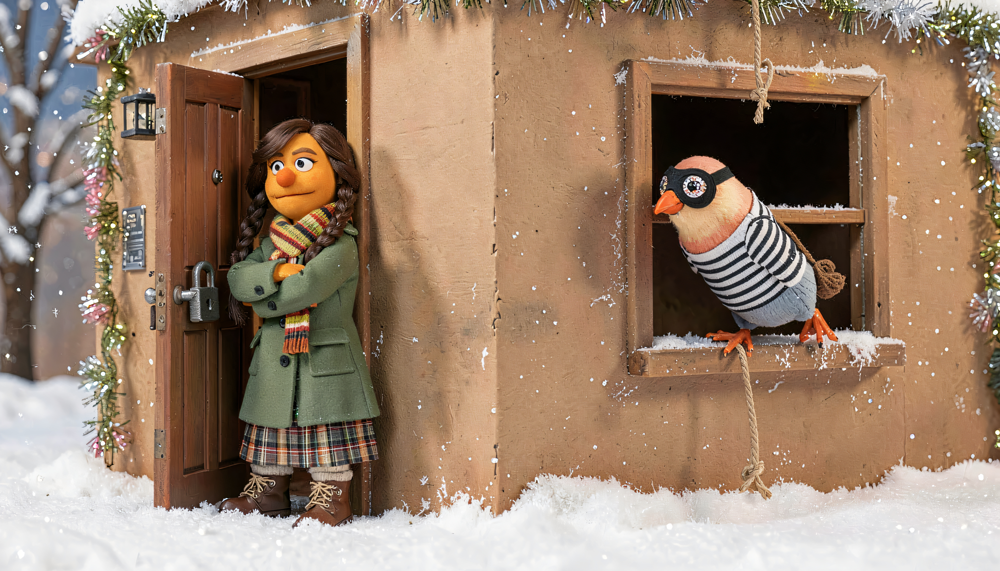

Used _Draw Things_

Prompt ideas:

1. The puppet character from Picture 1, keeping her face, felt texture and proportions exactly the same, with long dark brown hair in a loose low braid, wearing a white nurse's dress with a navy cardigan and flat low-top canvas sneakers, kneeling to bandage the one small wooden toy soldier with a real crack in his leg. Around her, teddy bears in huge dramatic bandages fill a toy hospital waiting room. A stuffed giraffe swoons onto a pillow pile, knocking over bandage rolls that unspool across the floor. Wide shot, her in the center. Storybook ink and watercolor illustration. No text or letters.

2. The puppet character from Picture 1, keeping her face, felt texture and proportions exactly the same, with long straight dark brown hair tucked behind her ears, wearing a long forest green pinafore dress over a cream blouse and flat low-top canvas sneakers, calmly holding up a single blank envelope. Behind her, an avalanche of blank envelopes pours through the open window of a cozy post office. A startled pigeon pops its head out of the envelope pile with an envelope stuck on its head. Medium shot from slightly below. Retro 1960s cartoon, thin outlines, warm limited palette. No text or letters.

3. The puppet character from Picture 1, keeping her face, felt texture and proportions exactly the same, with long wavy dark brown hair under a red fire marshal's helmet, wearing a long navy wool dress and flat low-top canvas sneakers, crouching to pinch out one tiny real spark on a theatre stage floor. A smoke machine fills the stage with huge billowing fog. A goose in a firefighter helmet sprays a hose at the fog and soaks a startled cellist. Wide shot from the audience seats. Flat 2D cartoon, bold shapes, clean outlines. No text or letters.

4. The puppet character from Picture 1, keeping her face, felt texture and proportions exactly the same, with long dark brown hair in a high ponytail, wearing a long plaid skirt, a cream cable-knit sweater and flat low-top canvas sneakers, standing on a short wooden stepladder to steady the one loose roof tile on a farmhouse. Below her, a crowd of chickens panics over acorns dropping from an oak tree. One chicken flaps so hard it lands upside down in the water trough, splashing the others. Low-angle wide shot. Gouache picture book painting, soft textured brushwork. No text or letters.

5. The puppet character from Picture 1, keeping her face, felt texture and proportions exactly the same, with long dark brown hair in a messy bun with loose strands, wearing a long navy swim-style dress with a white collar and flat low-top canvas sneakers, sitting on a lifeguard chair and tossing a striped float ring to one small duckling actually struggling in the water. Around the pool, a dozen otters splash and flail theatrically. An inflatable flamingo pops and launches an otter into the air. Wide shot from the pool deck. Cel-shaded cartoon, crisp shadows. No text or letters.

6. The puppet character from Picture 1, keeping her face, felt texture and proportions exactly the same, with long dark brown hair in two low pigtails, wearing a pale blue veterinarian's smock over a long grey skirt and flat low-top canvas sneakers, gently examining a quiet tortoise with a cracked shell. Behind her, a line of pets wears tiny dramatic bandages, a cat holding up one paw and a beagle howling. A parrot faints off its perch straight into a water bowl. Medium shot at table height. Mid-century modern illustration, geometric shapes, muted palette. No text or letters.

7. The puppet character from Picture 1, keeping her face, felt texture and proportions exactly the same, with long dark brown hair blowing in the wind, wearing a long navy sailor dress with a white collar and flat low-top canvas sneakers, calmly pressing a cork into the one real leak in a wooden ship's hull. Around her on deck, boxy robots built from wooden crates panic over a few seagull droppings. One robot slips on a mop bucket and slides into a stack of barrels. Wide shot across the deck. Linocut print, bold carved lines, two colors. No text or letters.

8. The puppet character from Picture 1, keeping her face, felt texture and proportions exactly the same, with long dark brown hair in a side braid, wearing a long burgundy medieval dress and flat low-top canvas sneakers, calmly swinging shut the one open side gate of a castle wall where a wolf is sneaking toward it. Up on the battlements, sheep in tin helmets panic at a harmless dragon kite in the sky. A tower of stacked sheep topples over into a pile of hay bales. Wide shot from the castle courtyard. Woodblock print, flat color areas, fine line detail. No text or letters.

9. The puppet character from Picture 1, keeping her face, felt texture and proportions exactly the same, with long dark brown hair pulled back with a headband, wearing a long lavender dress with a white apron and flat low-top canvas sneakers, turning the knob on the one oven with real flames inside. All around the bakery, toasters pop out puffs of harmless smoke. A cat baker jumps in fright and a bowl of flour explodes over a row of rabbits. Medium shot at counter height. Risograph print, grainy two-tone inks. No text or letters.

10. The puppet character from Picture 1, keeping her face, felt texture and proportions exactly the same, with long dark brown hair in a loose half-up style, wearing a long black velvet dress and flat low-top canvas sneakers, holding a lantern and gently lifting a tiny mouse away from the one rope that holds up a grand chandelier. Around her in a haunted house, rubber bats and plastic spiders terrify a group of boxy robots. The robots leap into each other's arms and collapse in a heap. Wide shot from the staircase. Paper cut-out collage, layered colored paper. No text or letters.

11. The puppet character from Picture 1, keeping her face, felt texture and proportions exactly the same, with long dark brown hair in a thick braid over one shoulder, wearing a long denim pinafore dress over a white shirt and flat low-top canvas sneakers, pressing her palm calmly over one small real crack in a stone dam. Beside her, a decorative fountain shoots a huge harmless geyser into the sky. A family of ducks rides the geyser spray and tumbles into a lily pond. Low-angle wide shot. Storybook ink and watercolor illustration. No text or letters.

12. The puppet character from Picture 1, keeping her face, felt texture and proportions exactly the same, with long dark brown hair under a wide straw hat, wearing a long olive green prairie dress and flat low-top canvas sneakers, calmly propping a board across one gap in a wooden fence where a fox is nosing through. Behind her, a flock of sheep panics at a scarecrow dressed as a wolf. The sheep pile into a woolly heap and one bounces off the top. Wide shot across a green meadow. Flat 2D cartoon, bold shapes, clean outlines. No text or letters.

13. The puppet character from Picture 1, keeping her face, felt texture and proportions exactly the same, with long dark brown hair in a low ponytail, wearing a long charcoal skirt, a teal turtleneck sweater and flat low-top canvas sneakers, quietly latching the one open window of a museum gallery. Behind her, a gang of raccoons rattles the locked glass display cases with great noise and effort. One raccoon pulls so hard it flips backward into a potted fern. Medium shot from inside the gallery. Retro 1960s cartoon, thin outlines, warm limited palette. No text or letters.

14. The puppet character from Picture 1, keeping her face, felt texture and proportions exactly the same, with long dark brown hair blowing loose in the sea wind, wearing a long navy raincoat dress and flat low-top canvas sneakers, turning a lighthouse lamp to shine on the one small sailboat drifting toward the rocks. Out on the water, a crowd of toy tugboats toot and spin in circles over nothing. A seal startled by the tooting topples off a rock into the waves. Wide shot from the lighthouse balcony. Gouache picture book painting, soft textured brushwork. No text or letters.

15. The puppet character from Picture 1, keeping her face, felt texture and proportions exactly the same, with long dark brown hair in a neat bun, wearing a long sage green dress with a beekeeper's veil hat and flat low-top canvas sneakers, calmly lifting the lid of the one beehive where a single wasp has slipped inside. Around the garden, a swarm of bees chases a harmless butterfly in a frantic loop. The bees crash into a laundry line and a bedsheet drops over a goat. Wide shot of the garden. Mid-century modern illustration, geometric shapes, muted palette. No text or letters.

16. The puppet character from Picture 1, keeping her face, felt texture and proportions exactly the same, with long straight dark brown hair worn loose, wearing a long royal blue dress with a white collar and flat low-top canvas sneakers, calmly placing one blank card into a small basket at a sorting table. Boxy robots made of building blocks rush in with armfuls of blank cards for the towering stack behind her. The stack topples and buries two robots up to their antennas. Over-the-shoulder shot from behind the robots, her facing the camera. Cel-shaded cartoon, crisp shadows. No text or letters.
