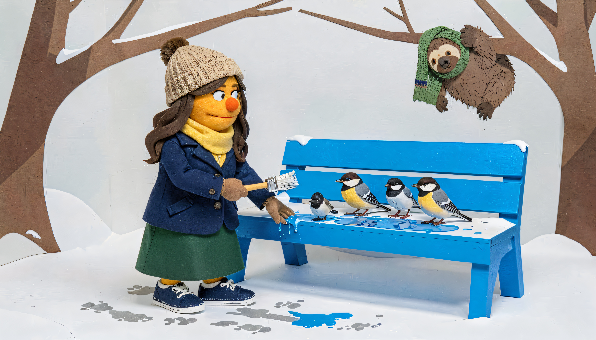

Used _Draw Things_

Prompt:

  The puppet character from Picture 1, keeping her face, felt texture and proportions exactly the same, curious and calm, with long wavy dark brown hair, wearing a navy parka, a yellow scarf, a knitted toque, mitts, a long emerald skirt and flat low-top canvas sneakers, painting a snowy garden bench bright blue with an oversized paintbrush. Chickadees line up along the backrest. A chickadee lands in the wet paint and tracks footprints everywhere. A sloth in a knitted scarf creeps slowly along a branch overhead. Three-quarter angle medium-wide shot. Paper cut-out cartoon, layered construction paper, soft shadows. No text or letters.

| Field | Value |
|---|---|
| Model | flux_2_klein_4b_q8p.ckpt |
| Steps | 7 |
| Sampler | DDIM Trailing |
| Guidance Scale | 1.0 |
| Seed | 3623620276 |
| Seed Mode | Scale Alike |
| Size | 1344x768 |
| Strength | 1.0 |
| Shift | 1.2 |
| CLIP Skip | 2 |
| Upscaler | 4x_ultrasharp_f16.ckpt |

Infill on her shoes:

  felt puppet character's feet, wide apart, exactly two navy felt sneakers, pointing right, snow

| Field | Value |
|---|---|
| Model | flux_2_klein_4b_q8p.ckpt |
| Steps | 7 |
| Sampler | DDIM Trailing |
| Guidance Scale | 1.2 |
| Seed | 3704723874 |
| Seed Mode | Scale Alike |
| Size | 1344x768 |
| Strength | 0.981 |
| Shift | 1.2 |
| CLIP Skip | 2 |
| Upscaler | 4x_ultrasharp_f16.ckpt |
| Mask Blur Outset | 18 |
