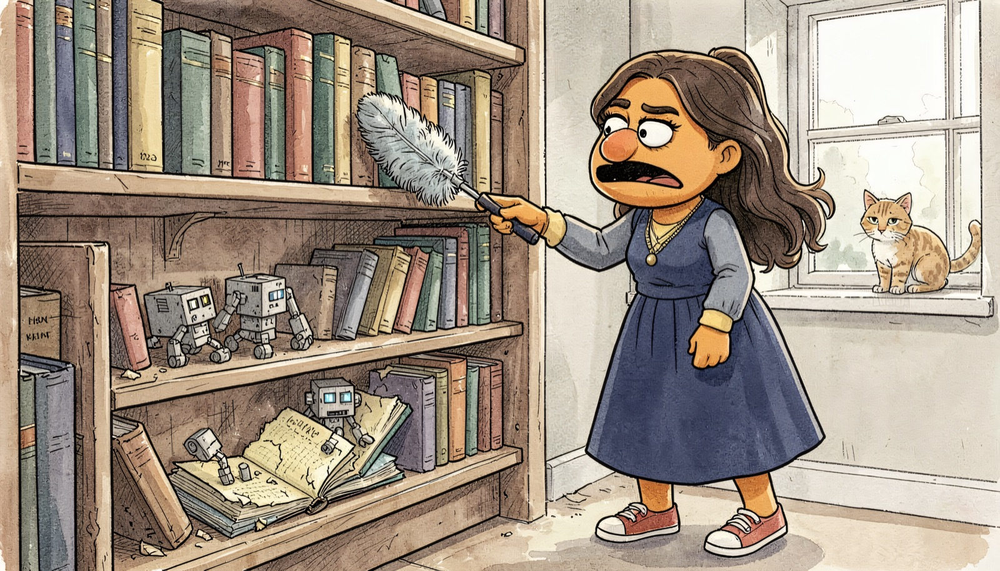

Used _Draw Things_

Prompt:

  muppetem, cartoon felt puppet, orange-peach felt skin, (very long dark brown hair falling past her waist:1.3), wearing a cream knit sweater and a long cranberry red ankle-length skirt, black skater shoes, (carrying a big armful of rolled paper scrolls:1.3), a few scrolls slipping from her arms, walking away from a tall crumbling stone library with cracked columns and falling dust, toward a sturdy little wooden cabin with a warm lit window and a plain blank welcome mat at the door, late afternoon light, determined expression, flat colours, bold outlines, (illustration:0.7)

Negative prompt:

  human, realistic person, real skin, text, letters, pants, trousers, jeans, orange clothing, peach clothing, skin-colored clothing, words, writing, writing on mat, signs, watermark, logo, photorealistic, plush, 3d render, short hair, extra fingers, deformed hands, blurry

| Field | Value |
|---|---|
| Model | SD3 Large Turbo 3.5 |
