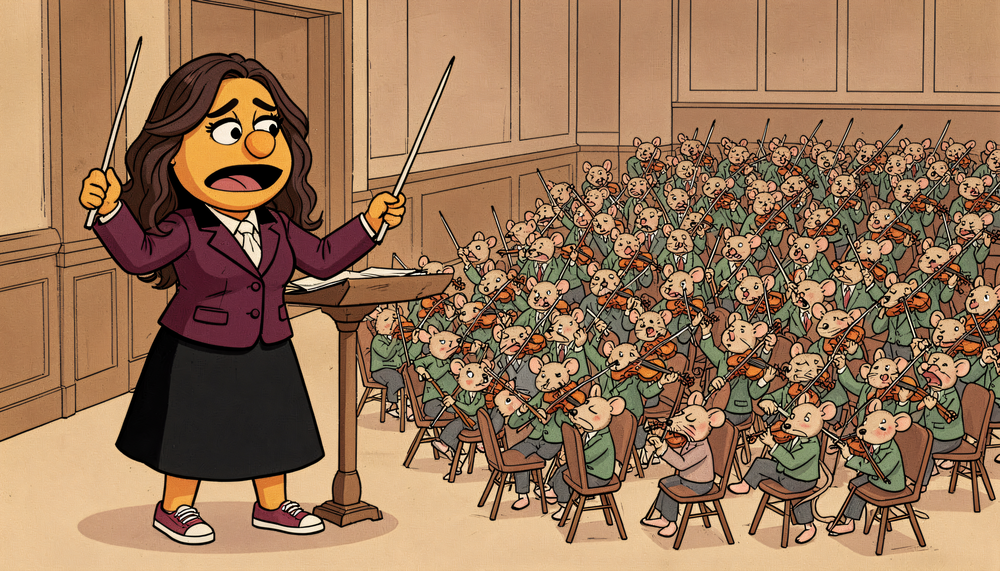

Used _Draw Things_

Prompt:

  muppetem, cartoon felt puppet, peachy-orange felt skin, very long dark brown hair falling past her waist, wearing a long emerald green ankle-length skirt and a cream blouse, black skater shoes, standing on a small conductor's podium raising a baton with an exasperated expression, (conducting a huge orchestra of tiny identical felt puppet musicians filling rows of chairs:1.3), only one tiny musician in the front row playing a violin, (every other tiny musician fast asleep slumped in their chair with their instrument in their lap:1.2), grand concert hall stage, warm stage lighting, flat colours, bold outlines, storybook style, (illustration:0.6)

Negative prompt:

  human, realistic person, real skin, text, letters, pants, trousers, jeans, orange clothing, peach clothing, photorealistic, photograph, 3d render, plush toy photo, words, sheet music, music notes, signs, watermark, logo, extra fingers, deformed, blurry, lowres

| Field | Value |
|---|---|
| Model | [AUTHOR: model used when you generate it] |
