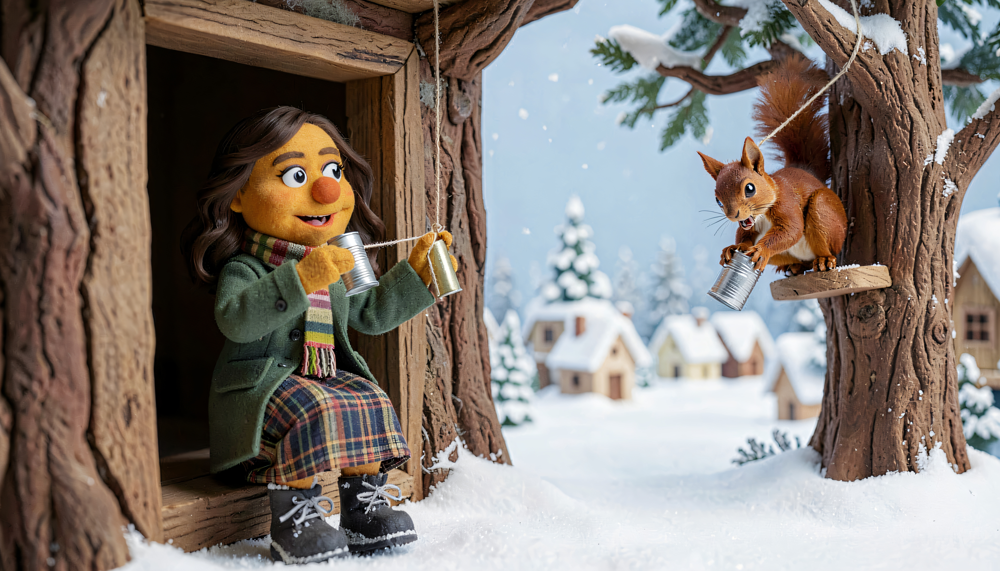

Used _Draw Things_

Prompt:

  The puppet character from Picture 1, same face, felt texture and proportions, with long wavy dark brown hair, wearing a long green duffle coat, a striped scarf and a long plaid skirt and snow boots, wide-eyed with delight, up on her toes, sitting in a treehouse doorway, chatting into a tin can on a string. A squirrel in a far treehouse ties on a new can. Snowy winter day, snow on the ground. The squirrel clutches the small new can, nervous. Extreme foreground: the small new can swings toward the lens, her in the middle distance. Stop-motion holiday special style, hand-sculpted puppets with glossy painted eyes, tiny snowy village set, soft studio lighting, stylized, not photorealistic. No text or letters.

| Field | Value |
|---|---|
| Model | flux_2_klein_4b_q8p.ckpt |
| Steps | 7 |
| Sampler | DDIM Trailing |
| Guidance Scale | 1.4 |
| Seed | 4033979631 |
| Seed Mode | Scale Alike |
| Size | 1344x768 |
| Strength | 1.0 |
| CLIP Skip | 2 |
| Upscaler | 4x_ultrasharp_f16.ckpt |
| Mask Blur Outset | 18 |
