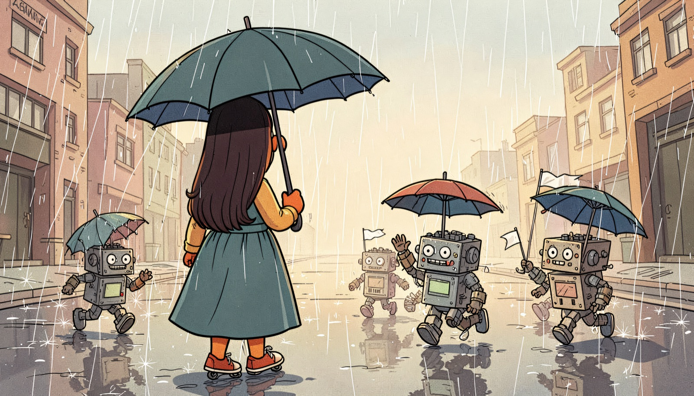

Used _Draw Things_

Prompt:

  The puppet character from Picture 1, keeping her face, felt texture and proportions exactly the same, with very long straight dark brown hair, wearing a long teal dress and skate shoes, holding a big umbrella in the rain. Beside her, tiny boxy robots made of building blocks run in late with tiny umbrellas. All their umbrellas flipped inside out. One robot waves a tiny white flag. Over-the-shoulder shot from behind the robots, her facing the camera. Retro 1960s cartoon, thin outlines, warm limited palette. No text or letters.

| Field | Value |
|---|---|
| Model | flux_2_klein_4b_q8p.ckpt |
| Steps | 7 |
| Sampler | DDIM Trailing |
| Guidance Scale | 1.4 |
| Seed | 1217479156 |
| Seed Mode | Scale Alike |
| Size | 1344x768 |
| Strength | 1.0 |
| Shift | 1.5 |
| CLIP Skip | 2 |
| Upscaler | 4x_ultrasharp_f16.ckpt |
