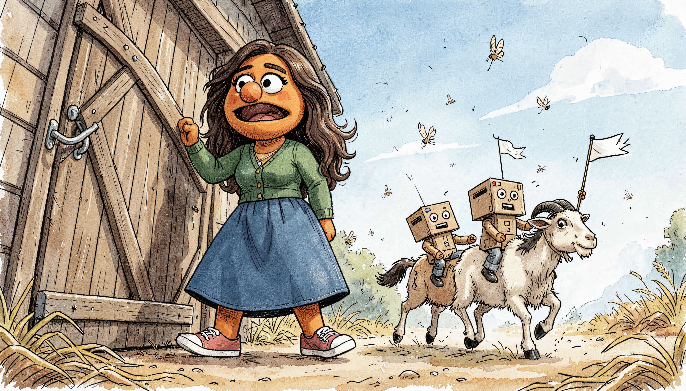

Used _Draw Things_

Prompt:

  muppetem, cartoon felt puppet, orange-peach felt skin, (very long dark brown hair flowing past her waist:1.3), cream knit sweater, (long midnight-blue ankle-length skirt:1.3), black skater shoes, standing on a wooden riverbank beside a small old wooden water gate, both hands pulling the gate lever open, (a flood of tiny white paper boats rushing through the open gate:1.3), early morning mist, soft sunrise light, calm wide river beyond with a quiet evening sky glowing at the far end, storybook landscape, (illustration:0.6)

Negative prompt:

  human, realistic person, real skin, text, letters, pants, trousers, jeans, orange clothing, plush, photo, photorealistic, 3d render, words, signs, watermark, short hair, short skirt, deformed hands, extra limbs, blurry

| Field | Value |
|---|---|
| Model | SD3 Large Turbo 3.5 |
