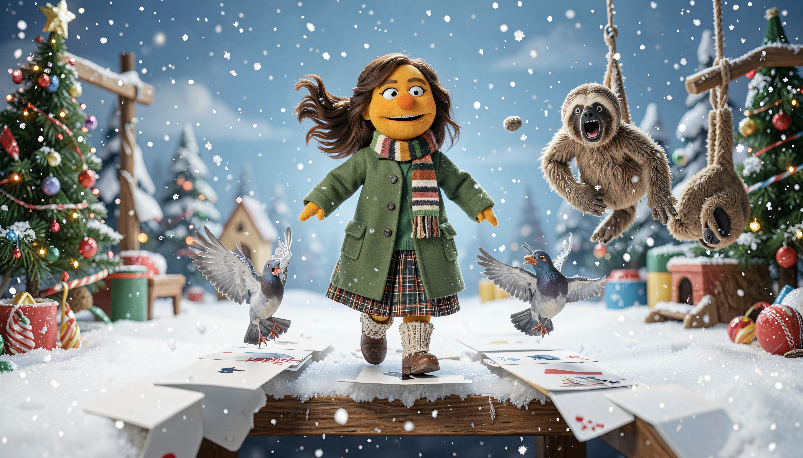

Used _Draw Things_

Prompt ideas:

1. The puppet character from Picture 1, keeping her face, felt texture and proportions exactly the same, with long dark brown hair in a low ponytail, wearing a long forest green dress and flat low-top white canvas sneakers, calmly reaching out to accept a parcel. A uniformed stork delivery bird hands her a plain brown box on her front porch. The box lid pops open and a swarm of tiny boxy robots bursts out, juggling her house keys. Medium shot, her in the center. Retro 1960s cartoon, thin outlines, warm limited palette. No text or letters.

2. The puppet character from Picture 1, keeping her face, felt texture and proportions exactly the same, with long wavy dark brown hair, wearing a navy blue midi skirt, a cream cardigan and flat low-top navy canvas sneakers, holding up a magnifying glass to a jar of cookies. She stands at a bakery counter where a smiling raccoon baker has just handed her the jar. Every cookie in the jar has tiny legs and is climbing out the top. Close-up over the counter. Storybook ink and watercolor illustration. No text or letters.

3. The puppet character from Picture 1, keeping her face, felt texture and proportions exactly the same, with long straight dark brown hair tucked behind her ears, wearing a plum ankle-length dress and flat low-top black canvas sneakers, calmly flipping a big red lever on a wall to switch something off. Behind her, a borrowed garden sprinkler on the lawn has gone wild. Water sprays sideways and soaks three startled geese, who flap into a hedge. Wide shot, her on the left. Flat 2D cartoon, bold shapes, bright colors. No text or letters.

4. The puppet character from Picture 1, keeping her face, felt texture and proportions exactly the same, with long dark brown hair in a loose braid, wearing a teal knee-length dress and flat low-top white canvas sneakers, sipping tea at a garden table. A neat row of identical cupcakes sits on a tiered stand delivered by a polite butler penguin. One cupcake opens like a lid and a small boxy robot inside sneaks away with her teaspoon while the penguin faints. Medium shot. Gouache picture book illustration. No text or letters.

5. The puppet character from Picture 1, keeping her face, felt texture and proportions exactly the same, with long curly dark brown hair, wearing a lemon yellow midi skirt, a white blouse and flat low-top grey canvas sneakers, calmly holding a fire extinguisher. She stands in a science lab beside two identical bubbling flasks on a table, one swapped while she looked away. The swapped flask erupts in purple foam that sends a lab mouse surfing across the table on a blank notebook. Medium wide shot. Cel-shaded cartoon, clean outlines. No text or letters.

6. The puppet character from Picture 1, keeping her face, felt texture and proportions exactly the same, with long dark brown hair under a wide sun hat, wearing a long denim-blue sundress and flat low-top white canvas sneakers, inspecting a plant through reading glasses. A friendly gardener goat has just planted a borrowed seedling in her flower bed. The seedling has sprouted long vines that tie up a garden gnome and snatch a watering can from a squirrel. Wide shot, her on the right. Linocut print, two-color ink. No text or letters.

7. The puppet character from Picture 1, keeping her face, felt texture and proportions exactly the same, with long dark brown hair in a high ponytail, wearing a burgundy pinafore dress over a white shirt and flat low-top burgundy canvas sneakers, calmly holding a lantern up to look inside a wooden crate. The crate sits on a dock, just lifted off a ship by a seagull crew. Inside, a dozen tiny boxy robots freeze mid-tiptoe, and one drops a stack of blank papers that scatter on the wind. Low angle shot. Woodblock print, muted inks. No text or letters.

8. The puppet character from Picture 1, keeping her face, felt texture and proportions exactly the same, with long sleek dark brown hair, wearing a charcoal pencil skirt, a lilac blouse and flat low-top white canvas sneakers, unplugging a borrowed desk lamp from the wall. The lamp has bent its neck around to peek at her blank notebook. Her cat, startled, leaps into a stack of blank books that topple like dominoes. Medium shot at desk height. Mid-century modern illustration, geometric shapes, muted palette. No text or letters.

9. The puppet character from Picture 1, keeping her face, felt texture and proportions exactly the same, with long dark brown hair in two low braids, wearing a long sage green skirt, a white sweater and flat low-top green canvas sneakers, calmly catching a falling teacup. She stands in a busy kitchen where a hired octopus chef juggles pots. One tentacle has quietly swapped her sugar bowl for a bowl of wriggling jelly, and a parrot shrieks as the jelly bounces onto its head. Wide shot. Risograph print cartoon, grainy two-tone inks. No text or letters.

10. The puppet character from Picture 1, keeping her face, felt texture and proportions exactly the same, with long wavy dark brown hair, wearing a cobalt blue tea-length dress and flat low-top white canvas sneakers, holding a large magnet over a plain gift basket. The basket was left at her door by a mail carrier fox who is already sprinting away. Tiny boxy robots hidden among the apples cling helplessly to the magnet in a dangling chain. Medium shot. Paper cut-out collage style, layered textures. No text or letters.

11. The puppet character from Picture 1, keeping her face, felt texture and proportions exactly the same, with long dark brown hair in a messy bun with loose strands, wearing a mint green shirtdress and flat low-top white canvas sneakers, calmly fitting a padlock on a garden shed. A borrowed ladder leaning on the shed has bent itself to reach a bird feeder. A chain reaction follows as birdseed spills, pigeons swarm and a startled badger tumbles into a pile of leaves. Wide shot. Storybook ink and watercolor illustration. No text or letters.

12. The puppet character from Picture 1, keeping her face, felt texture and proportions exactly the same, with long straight dark brown hair, wearing a deep red midi skirt, a navy striped top and flat low-top navy canvas sneakers, sitting cross-legged on a picnic blanket and opening a plain wicker hamper. A courier owl just dropped the hamper from above. Inside, a small boxy robot is swapping every sandwich for a rubber duck, and nearby ants march off with the real sandwiches. Overhead shot. Flat 2D cartoon, soft pastel colors. No text or letters.

13. The puppet character from Picture 1, keeping her face, felt texture and proportions exactly the same, with long dark brown hair in a side braid, wearing a lavender ankle-length dress and flat low-top white canvas sneakers, calmly holding a pair of scissors over a bunch of balloon strings. She stands at a party where a hired clown seal handed out the balloons. Every balloon carries a small boxy robot dangling underneath, and one has snagged the party cake, which flips onto a dog. Medium wide shot. Retro 1960s cartoon, thin outlines, warm limited palette. No text or letters.

14. The puppet character from Picture 1, keeping her face, felt texture and proportions exactly the same, with long curly dark brown hair, wearing a forest green pinafore dress over a cream shirt and flat low-top brown canvas sneakers, peering into the back of a borrowed music box with a small screwdriver. The music box sits on a shelf in a cozy library full of blank books. Instead of a tune, it sprays bubbles that send a dozing hedgehog floating up toward the ceiling. Close-up shot. Gouache picture book illustration. No text or letters.

15. The puppet character from Picture 1, keeping her face, felt texture and proportions exactly the same, with long dark brown hair tucked behind her ears, wearing a slate blue wrap dress and flat low-top white canvas sneakers, calmly closing a garden gate. Behind her, a trusted delivery horse has carried in a hay bale that is unravelling into a flock of tiny boxy robots. The robots chase a terrified rooster in circles around a well. Wide shot, her in the foreground. Cel-shaded cartoon, clean outlines. No text or letters.

16. The puppet character from Picture 1, keeping her face, felt texture and proportions exactly the same, with long wavy dark brown hair, wearing a teal midi skirt, a white blouse and flat low-top teal canvas sneakers, carefully lifting the lid of a silver serving dish with one finger. A tuxedoed walrus waiter presents the dish with pride at a fancy dinner table. Under the lid a small boxy robot is pocketing the silverware, and the walrus drops the tray in shock. Medium shot at table height. Mid-century modern illustration, geometric shapes. No text or letters.

17. The puppet character from Picture 1, keeping her face, felt texture and proportions exactly the same, with long dark brown hair in a low bun, wearing a navy knee-length dress and flat low-top white canvas sneakers, calmly holding up a lantern in a castle hallway. A gift suit of armor with a bow stands by the wall. The visor has popped open to reveal a nervous boxy robot inside, and a startled bat knocks over a candelabra, which tips a row of tall vases over like dominoes. Low angle shot. Linocut print, two-color ink. No text or letters.

18. The puppet character from Picture 1, keeping her face, felt texture and proportions exactly the same, with long straight dark brown hair, wearing a plum tea-length dress and flat low-top black canvas sneakers, calmly turning off a water tap on a borrowed garden fountain. A trio of ducks had splashed happily in the fountain until it started spouting tiny boxy robots instead of water. One duck is flung into the air while the others dive into a bush. Wide shot. Woodblock print, muted inks. No text or letters.
